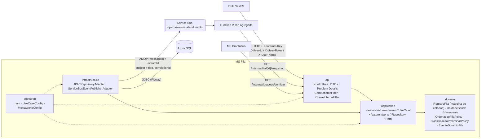

# Open Prontuário — MS Fila (Azure SQL)

Microserviço de **Unidades, Lotações e Fila** do Open Prontuário (PJBL). Ele guarda a fila das UPAs/UBS
em **Azure SQL**, aplica a máquina de estados do `RegistroFila`, ordena a fila por prioridade clínica e
**publica um evento no Azure Service Bus a cada mudança de estado**. A Function Visão Agregada consome
esses eventos.

Só o **BFF** chama as rotas de usuário. A Function e o MS Prontuário usam as rotas `/internal/**`.
Toda chamada exige o cabeçalho `X-Internal-Key`.

## Arquitetura

Clean Architecture com **Vertical Slice**: cada caso de uso tem o próprio pacote dentro da sua feature
(`unidade`, `lotacao`, `fila`).



Regras verificadas pelo **ArchUnit** (`src/test/java/.../arquitetura/ArquiteturaTest.java`):

- `api → application → domain` e `infrastructure → application → domain`;
- `api` e `infrastructure` não se conhecem; só o `bootstrap` (composition root) enxerga tudo;
- `domain` usa apenas Java puro (sem Spring, JPA ou Azure);
- `application` só depende de `domain` e `java.*`;
- os casos de uso não têm anotações de framework, têm um único método público `executar` e são instanciados com `@Bean` em `UseCaseConfig`;
- controllers só usam classes `*UseCase`, `*Command` e `*Result`, nunca portas ou adapters;
- convenções de nomes: `*UseCase`, `*Controller` e `*Adapter`; portas são interfaces `*Repository` ou `*Port`;
- não há ciclos entre camadas nem entre features.

**Prova de que o teste falha.** Duas violações foram introduzidas temporariamente e revertidas, sem commit:
`@org.springframework.stereotype.Component` em `ClassificacaoPreliminarPolicy` (domínio) e um campo
`RegistroFilaRepository` (porta) em `FilaInternaController`. O resultado foi
`Tests run: 14, Failures: 4`, com estas regras violadas:

- `dominio_eh_java_puro`
- `dominio_sem_spring_jpa_nem_azure`
- `api_nao_acessa_portas_nem_infraestrutura`
- `controllers_so_usam_casos_de_uso_da_aplicacao`

## Tecnologias

| Item | Tecnologia |
|---|---|
| Linguagem / build | Java 17, Maven (wrapper `./mvnw`) |
| Framework | Spring Boot 3.5.16 (web, validation, data-jpa, actuator) |
| Banco | Azure SQL / SQL Server 2022, `mssql-jdbc`, Flyway (`flyway-sqlserver`) |
| Mensageria | Azure Service Bus (`azure-messaging-servicebus`) |
| Documentação | springdoc-openapi 2.8 (Swagger UI) |
| Testes | JUnit 5, AssertJ, Mockito, MockMvc, ArchUnit 1.4, Testcontainers (MSSQL), JaCoCo |
| Contêiner | Docker multi-stage (Temurin 17) |

## Estrutura de pastas

```
src/main/java/br/com/openprontuario/fila/
├── domain/                     # Java puro
│   ├── model/                  # RegistroFila, UnidadeSaude, Lotacao, Paciente, enums
│   ├── policy/                 # OrdenacaoFilaPolicy, ClassificacaoPreliminarPolicy
│   ├── event/                  # EventoDominioFila, EventoFila
│   └── exception/              # DomainException e subclasses
├── application/                # casos de uso (vertical slice) + portas
│   ├── unidade/   {listarunidades, listarproximas, listarminhas, buscarunidade,
│   │               criarunidade, atualizarunidade, removerunidade, ports}
│   ├── lotacao/   {listarlotacoes, criarlotacao, removerlotacao,
│   │               listarlotacoesdousuario, verificarlotacao, ports}
│   └── fila/      {avisarchegada, listarfila, confirmarchegada, alterarprioridade,
│                   iniciaratendimento, removerdafila, snapshot, ports}
├── infrastructure/
│   ├── persistence/            # *Entity, Spring Data, *RepositoryAdapter
│   └── messaging/              # ServiceBusEventPublisherAdapter, LogEventPublisherAdapter
├── api/
│   ├── comum/                  # RestExceptionHandler, filtros, OpenApiConfig
│   ├── unidade/ lotacao/ fila/ # controllers e DTOs por feature
└── bootstrap/                  # OpenProntuarioFilaApplication, UseCaseConfig, MensageriaConfig
src/main/resources/db/migration/  V1__schema.sql, V2__seed.sql
contract/ms-fila-sql.openapi.yaml # cópia do contrato (teste de contrato)
```

## Rotas

| Método e rota | Caso de uso | Observação |
|---|---|---|
| `GET /unidades` · `POST /unidades` | `ListarUnidadesUseCase`, `CriarUnidadeUseCase` | CRUD (o BFF exige GESTOR) |
| `GET/PUT/DELETE /unidades/{unidadeId}` | `Buscar/Atualizar/RemoverUnidadeUseCase` | `409 UNIDADE_EM_USO` se tiver lotação ou registro |
| `GET /unidades/proximas?latitude=&longitude=&raioKm=` | `ListarUnidadesProximasUseCase` | RF02, distância por Haversine |
| `GET /unidades/minhas` | `ListarMinhasUnidadesUseCase` | RF07, a partir das lotações |
| `GET/POST /lotacoes`, `DELETE /lotacoes/{id}` | `Listar/Criar/RemoverLotacaoUseCase` | `409 LOTACAO_DUPLICADA` |
| `POST /fila/{unidadeId}/aviso-chegada` | `AvisarChegadaUseCase` | RF03/04: paciente = `X-User-Id`, upsert com `X-User-Name` |
| `GET /fila/{id}` (id = **unidade**) | `ListarFilaPorPrioridadeUseCase` | RF08/09, exige lotação na unidade |
| `POST /fila/{registroId}/confirmar-chegada` | `ConfirmarChegadaUseCase` | `A_CAMINHO → AGUARDANDO` |
| `PATCH /fila/{registroId}/prioridade` | `AlterarPrioridadeUseCase` | só em `A_CAMINHO`/`AGUARDANDO` |
| `POST /fila/{registroId}/iniciar-atendimento` | `IniciarAtendimentoUseCase` | `AGUARDANDO → EM_ATENDIMENTO` |
| `DELETE /fila/{id}?motivo=` (id = **registro**) | `RemoverDaFilaUseCase` | encerra como `FINALIZADO`, sem apagar |
| `GET /internal/fila/{unidadeId}/snapshot` | `ObterSnapshotFilaUseCase` | para a Function; sem dados pessoais |
| `GET /internal/lotacoes`, `GET /internal/lotacoes/verificar` | `ListarLotacoesDoUsuario/VerificarLotacaoUseCase` | para o MS Prontuário |

Os erros seguem a RFC 9457 (`application/problem+json`) e trazem `codigo` e `correlationId`, conforme a
tabela da CONVENCOES §4. O serviço responde:

| Situação | Status e `codigo` |
|---|---|
| Sem `X-Internal-Key`, ou sem `X-User-Id` numa rota de usuário | `401 NAO_AUTENTICADO` |
| Usuário não lotado na unidade | `403 SEM_PERMISSAO` |
| Recurso inexistente | `404` |
| Transição inválida | `409 TRANSICAO_INVALIDA` |
| Registro ativo duplicado | `409 REGISTRO_ATIVO_DUPLICADO` |
| Banco indisponível | `503 DEPENDENCIA_INDISPONIVEL` |

## Eventos publicados (Service Bus)

Os eventos vão para o tópico `eventos-atendimento`, sempre **depois** de salvar o registro. O contrato
completo está em `asyncapi.yaml`, no repositório `open-prontuario-platform`.

| Evento (`tipo`) | Publicado por | Transição |
|---|---|---|
| `PACIENTE_A_CAMINHO` | `AvisarChegadaUseCase` | → `A_CAMINHO` |
| `PACIENTE_CHEGOU` | `ConfirmarChegadaUseCase` | `A_CAMINHO → AGUARDANDO` |
| `PRIORIDADE_ALTERADA` | `AlterarPrioridadeUseCase` | status inalterado |
| `ATENDIMENTO_INICIADO` | `IniciarAtendimentoUseCase` | `AGUARDANDO → EM_ATENDIMENTO` |
| `PACIENTE_REMOVIDO` | `RemoverDaFilaUseCase` | → `FINALIZADO` |

O corpo é `EventoFilaMessage` (`eventoId`, `tipo`, `registroId`, `unidadeId`, `statusAnterior`, `statusAtual`,
`prioridade`, `ocorridoEm`, `versao: 1`), **sem nome, CPF, sintomas nem pacienteId** (LGPD).

Propriedades AMQP:

- `messageId = eventoId`;
- `subject = tipo`;
- `contentType = application/json`;
- `correlationId` = `X-Correlation-Id` da requisição. Se não houver, é gerado um UUID, para que a mensagem nunca saia sem esse valor.

Se a publicação falhar, a falha é logada e a operação **não** é desfeita. A visão agregada é recalculada a
partir do estado e se corrige no próximo evento; a *Transactional Outbox* fica como débito técnico.
Com `SERVICEBUS_CONNECTION_STRING` vazia, o serviço sobe em **modo de desenvolvimento explícito**: emite um
WARN `mensageria desabilitada` na inicialização e apenas loga cada evento.

## Variáveis de ambiente

| Variável | Exemplo | Obrigatória |
|---|---|---|
| `PORT` | `8081` | não (padrão 8081) |
| `DB_URL` | `jdbc:sqlserver://mssql:1433;databaseName=openprontuario;encrypt=true;trustServerCertificate=true` | sim |
| `DB_USER` / `DB_PASSWORD` | `sa` / `<senha>` | sim |
| `SERVICEBUS_CONNECTION_STRING` | `Endpoint=sb://...` (vazia = mensageria desabilitada) | não |
| `SERVICEBUS_TOPIC` | `eventos-atendimento` | não |
| `INTERNAL_API_KEY` | `dev-internal-key` | **sim** (sem padrão; o serviço não sobe sem ela) |

Veja `.env.example`. **Nunca versione o `.env`.**

## Como rodar localmente (SQL Server em Docker)

```bash
# 1. SQL Server 2022 (só existe imagem amd64; em Apple Silicon roda emulado e leva ~40 s)
docker run -d --name mssql --platform linux/amd64 -p 1433:1433 \
  -e ACCEPT_EULA=Y -e 'MSSQL_SA_PASSWORD=Senha_Forte_123!' mcr.microsoft.com/mssql/server:2022-latest

# 2. Cria o banco (o Flyway cria tabelas e seed na inicialização)
docker exec mssql /opt/mssql-tools18/bin/sqlcmd -C -S localhost -U sa -P 'Senha_Forte_123!' \
  -Q "CREATE DATABASE openprontuario"

# 3. Sobe o serviço
export DB_PASSWORD='Senha_Forte_123!' INTERNAL_API_KEY=dev-internal-key
./mvnw spring-boot:run
```

A mesma coisa usando a imagem:

```bash
docker build -t ms-fila-sql:local .
docker run --rm -p 8081:8081 \
  -e 'DB_URL=jdbc:sqlserver://host.docker.internal:1433;databaseName=openprontuario;encrypt=true;trustServerCertificate=true' \
  -e DB_USER=sa -e 'DB_PASSWORD=Senha_Forte_123!' -e INTERNAL_API_KEY=dev-internal-key ms-fila-sql:local
```

O sistema completo (com o emulador do Service Bus, a Function e o BFF) sobe pelo `compose.yml` do
repositório `open-prontuario-platform`.

### Apontando para a nuvem (Azure SQL + Service Bus)

```bash
export DB_URL='jdbc:sqlserver://<servidor>.database.windows.net:1433;databaseName=openprontuario;encrypt=true;trustServerCertificate=false;loginTimeout=30'
export DB_USER='<usuario>' DB_PASSWORD='<senha>'
export SERVICEBUS_CONNECTION_STRING='Endpoint=sb://<namespace>.servicebus.windows.net/;SharedAccessKeyName=...;SharedAccessKey=...'
export INTERNAL_API_KEY='<segredo compartilhado com o BFF>'
./mvnw spring-boot:run
```

No Azure SQL, o banco já vem criado pelo provisionamento (Bicep) e o Flyway aplica as migrações na subida.

### Exemplos de chamada

```bash
H=(-H 'X-Internal-Key: dev-internal-key')
curl "${H[@]}" -H 'X-User-Id: pac-101' -H 'X-User-Roles: PACIENTE' \
  'localhost:8081/unidades/proximas?latitude=-25.44&longitude=-49.22'
curl "${H[@]}" -H 'X-User-Id: pac-101' -H 'X-User-Name: João Pereira' -H 'Content-Type: application/json' \
  -X POST localhost:8081/fila/upa-01/aviso-chegada -d '{"sintomas":["dor no peito"],"tempoEstimadoChegadaMin":15}'
curl "${H[@]}" -H 'X-User-Id: usr-atendente-07' localhost:8081/fila/upa-01
curl "${H[@]}" -H 'X-User-Id: usr-atendente-07' -X POST localhost:8081/fila/<registroId>/confirmar-chegada
curl "${H[@]}" localhost:8081/internal/fila/upa-01/snapshot
```

O seed (`V2__seed.sql`) cria:

- as unidades `upa-01`, `upa-02` e `ubs-03`;
- as lotações `lot-1` … `lot-6` das personas `usr-atendente-07`, `usr-prof-03` e `usr-gestor-01`;
- os pacientes `pac-101` e `pac-102`.

## Swagger

| Recurso | Endereço |
|---|---|
| Swagger UI (público, sem chave) | `http://localhost:8081/swagger-ui.html` |
| OpenAPI JSON | `http://localhost:8081/v3/api-docs` |
| Em nuvem | `https://<PREENCHER>/swagger-ui.html` |
| Health | `/actuator/health` |

## Como testar

```bash
./mvnw verify                 # sem Docker
./mvnw verify -Pintegration   # + testes *IT com Testcontainers (precisa de Docker)
```

O `./mvnw verify` roda, sem Docker:

- domínio: todas as transições válidas e inválidas, classificação, ordenação e Haversine;
- casos de uso com Mockito: 403 para usuário não lotado, 409 para registro duplicado, campos do evento e falha de publicação que não desfaz a operação;
- `@WebMvcTest` dos controllers: status, Problem Details e cabeçalhos;
- adapter do Service Bus com `ServiceBusSenderClient` mockado;
- **ArchUnit**;
- **teste de contrato**, que compara as rotas do `/v3/api-docs` com `contract/ms-fila-sql.openapi.yaml`;
- **JaCoCo**: o build falha se `domain` + `application` tiverem menos de 80% de linhas ou de ramos cobertos.

O `-Pintegration` sobe um SQL Server 2022 real e valida:

- as migrações Flyway e o seed;
- os adapters JPA;
- o índice único filtrado (um registro ativo por paciente/unidade);
- a consulta de snapshot;
- um fluxo HTTP completo, do aviso ao encerramento.

## Imagem Docker

```bash
docker build -t <usuario>/pjbl/ms-fila-sql:<tag> .
docker login
docker push <usuario>/pjbl/ms-fila-sql:<tag>
```

A imagem roda com usuário não-root (UID 10001) e tem `HEALTHCHECK` em `/actuator/health` e
`JAVA_TOOL_OPTIONS=-XX:MaxRAMPercentage=75`.

Docker Hub: `https://hub.docker.com/r/<usuario>/pjbl` (**PREENCHER** após o push).

## Decisões e débitos conhecidos

- **Sintomas:** guardados como array JSON em `NVARCHAR(MAX)`, com `CHECK (ISJSON(...) = 1)`, porque são sempre lidos junto com o registro.
- **Registro ativo único:** a regra de um registro ativo por paciente/unidade é verificada no caso de uso e também garantida por índice único filtrado (`WHERE status <> 'FINALIZADO'`).
- **`justificativa` não é persistida:** o `PATCH /fila/{id}/prioridade` aceita o campo, como manda o contrato, mas o `RegistroFila` não tem onde guardá-lo.
- **Sem Transactional Outbox:** a publicação de eventos não usa outbox (débito técnico registrado no arc42).
- **Unidades próximas filtradas em memória:** basta para dezenas de unidades. Com milhares, o próximo passo é filtrar antes por *bounding box* no SQL.

## Alunos

- Ana Paula Alves
- Artur Bertoni
- Bernardo Plottegher
- Luiz Fernando Grenteski
